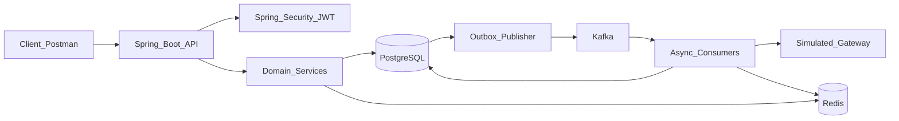
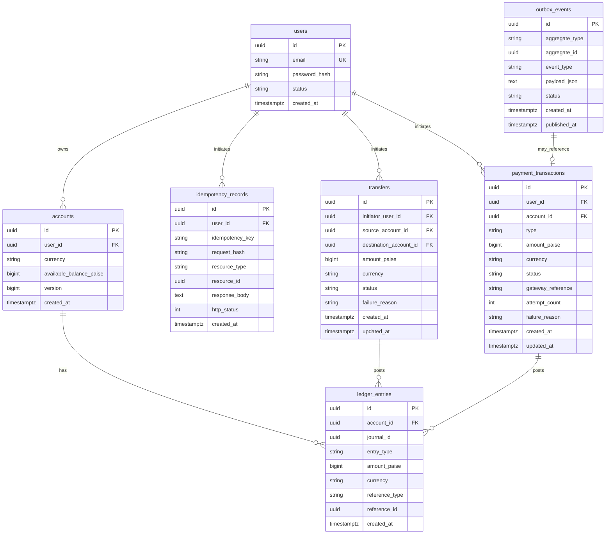
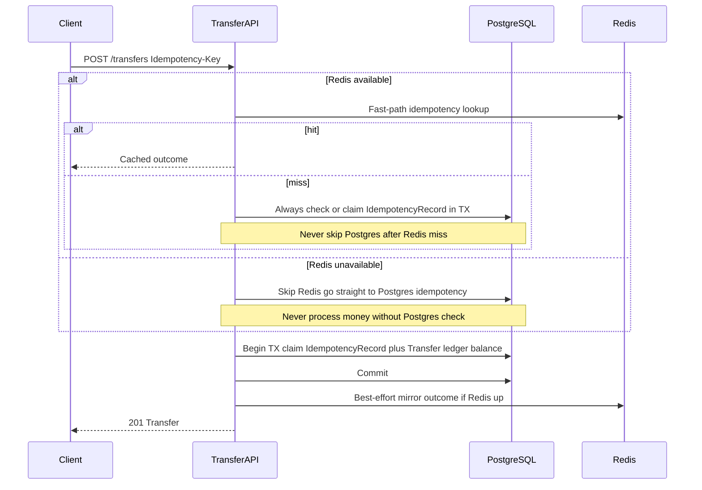
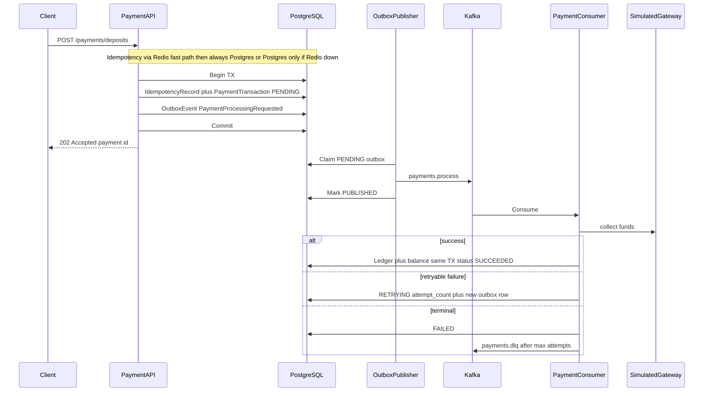

# Payment Processing System — Project Plan

A finishable solo portfolio backend that demonstrates SDE-1 / entry-level backend and system-design skills: financial correctness, idempotency, concurrency, async reliability, and clean domain modeling — without building a full Stripe clone or integrating real card networks.

**Document status:** Planning only. No application code until this plan is reviewed and implementation is explicitly approved.

---

## 1. Project overview and goals

### What we are building

A simplified Stripe/PayPal-style **wallet and money-movement backend** where authenticated users:

- Own INR wallets (accounts) with balances
- Move money between wallets via **internal transfers**
- Fund or cash out wallets via a **simulated payment gateway** (deposits / withdrawals)
- View ledger-backed transaction history
- Experience realistic failure, retry, and idempotent API behavior

### Goals

1. **Interview-ready depth** — Be able to explain every major design choice (ledger, outbox, idempotency, locking) clearly.
2. **Financial seriousness** — Treat money as an invariant problem, not “just update a balance column.”
3. **Finishability** — One modular Spring Boot app a single developer can complete and demo.
4. **Meaningful use of the required stack** — Each technology solves a real problem in this domain (not decoration).

### Non-product goals

- Simulated gateway only (configurable success / failure / timeout).
- INR only in V1; amounts in **integer paise**.
- REST API + OpenAPI + Postman as the “UI.”

---

## 2. Scope and non-goals

### V1 (in scope — build this)

| Area | What |
| --- | --- |
| Identity | Register, login, JWT access + refresh, logout (token denylist) |
| Wallet | Open account, read balance (materialized from ledger discipline) |
| Transfer | User → user P2P; **domain type `Transfer`**; no gateway |
| Payment | Gateway-backed **deposit** and **withdrawal** only; domain type `PaymentTransaction` |
| Ledger | Double-entry posts; source of truth for money |
| Correctness | Optimistic locking, unique constraints, same-TX ledger + balance |
| Idempotency | Postgres authoritative; Redis fast path |
| Async | Transactional **outbox** → Kafka → consumers; retries + DLQ |
| Infra | Host-local **PostgreSQL 18**, Redis, and Kafka as each milestone needs them; Spring Boot on the host; Swagger, Postman. Docker Compose is **not** used for V1 (machine RAM); keep config Docker-compatible for later. |
| Currency | **INR** only; `amountPaise` |

### V2+ (later — do not block V1)

- Multi-currency / FX
- Merchant checkout / PaymentIntent-style product APIs
- Merchant webhooks
- Admin console, disputes, chargebacks
- Debezium / CDC-based outbox (V1 uses app-managed outbox publisher)
- Prometheus / Grafana, full CQRS read models
- Rich frontend

### Excluded entirely

- Real card networks, UPI PSP production integration, PCI-DSS scope
- Microservices, Kubernetes, service mesh
- Blockchain, ML fraud engines, GraphQL
- Calling P2P movements “payments” in types, tables, or logs

### Naming rule (critical)

| Concept | Name | Gateway? |
| --- | --- | --- |
| Internal P2P | **Transfer** | No |
| Deposit / withdrawal | **PaymentTransaction** | Yes (simulated) |

APIs may sit under product-looking paths, but **packages, entities, tables, and logs** keep Transfer and PaymentTransaction distinct. Never refer to a P2P transfer as a “payment” internally.

---

## 3. Recommended architecture

### Choice: modular monolith

One Spring Boot 3.x application on **Java 21**, organized by **package modules** (bounded contexts), not separately deployable services.



### Why this shape

| Decision | Why | Alternative considered |
| --- | --- | --- |
| Modular monolith | Solo-finishable; same domain boundaries you would split later | Microservices — ops and distributed-transaction overhead kills portfolio V1 |
| Package-by-module | Clear ownership (`transfer` vs `payment`) without multi-repo pain | Package-by-layer only — weaker interview story for bounded contexts |
| Outbox → Kafka | Avoids dual-write; demonstrates reliability patterns | Direct `save` then `kafkaTemplate.send` — loses events on crash after commit |
| Simulated gateway | Shows async payment lifecycle without PCI / API keys | Real Stripe sandbox — credential noise, less control over failure modes |

### Hard rule: no direct API → Kafka publish

The HTTP layer **never** publishes to Kafka after a business write. It writes domain rows + **outbox** rows in **one Postgres transaction**. An outbox publisher emits to Kafka; consumers process with idempotency.

---

## 4. Domain model and modules

### Modules (packages, not deployables)

```
com.portfolio.paymentsystem
├── identity      # users, auth, JWT, refresh tokens
├── wallet        # accounts / balances (materialized)
├── ledger        # journal posts, invariants, history queries
├── transfer      # P2P Transfer lifecycle
├── payment       # PaymentTransaction deposit/withdrawal
├── gateway       # SimulatedPaymentGateway port + adapter
├── outbox        # OutboxEvent entity, publisher, marking published
└── common        # Money (paise), errors, idempotency helpers
```

### Core entities

| Entity | Responsibility |
| --- | --- |
| **User** | Credentials, status, roles |
| **Account** | Wallet per user; currency fixed `INR`; `availableBalancePaise` (materialized); `@Version` |
| **LedgerEntry** | Immutable debit/credit lines in **paise**; ties to a journal / movement; **source of truth** |
| **Transfer** | Internal P2P: source/dest accounts, amount, status, idempotency linkage |
| **PaymentTransaction** | `DEPOSIT` \| `WITHDRAWAL`; gateway reference; attempt count; failure reason |
| **OutboxEvent** | Pending Kafka payload; written in same TX as domain change |
| **IdempotencyRecord** | Postgres SoT for client `Idempotency-Key` → outcome |

### Aggregate / ownership intuition

- **Ledger** owns money truth; wallet balance is a denormalized read optimization.
- **Transfer** owns internal movement lifecycle; posts ledger when completing.
- **Payment** owns gateway-backed lifecycle; consumers post ledger after gateway success.
- **Outbox** is infrastructure glued to domain commits, not a business aggregate.

### Why separate Transfer and PaymentTransaction

A single polymorphic `Payment` with a `type` enum is schema-simpler but **language-muddier**. Interviewers ask “what happens if the gateway is down?” — for Transfer the answer is “nothing, we never call it.” Distinct types make that obvious.

---

## 5. Feature breakdown

### V1 features (priority order)

1. **Health + OpenAPI** — Prove the app boots on the host against local PostgreSQL 18.
2. **Auth** — Register / login / refresh / logout.
3. **Account** — Create wallet, get my account.
4. **Ledger primitives** — Post balanced journal + update balances in one TX; unit tests for invariants.
5. **Transfer** — Create P2P transfer with idempotency; ledger post on success (sync in-request).
6. **Outbox publisher** — Used by payment deposit/withdrawal only.
7. **Deposit / withdrawal** — Create `PaymentTransaction` + outbox; consumer calls gateway; ledger on success; retries / DLQ.
8. **History APIs** — Ledger / transfer / payment reads.
9. **Redis** — Idempotency fast path (with mandatory Postgres fallback), JWT denylist, rate limits.
10. **Hardening** — Problem+JSON errors, Postman collection, README, resume bullets.

### Optional polish inside V1 (if time)

- Light reconciliation endpoint/job: `SUM(ledger)` vs `available_balance_paise`
- Admin role stub (no full admin UI)

### Explicitly not V1 product features

- Cards, mandates, recurring billing, marketplace splits, KYC workflows

---

## 6. Data model / ER diagram

### ER (logical)



### Key constraints

- `accounts.currency` check / app rule: only `INR`
- `idempotency_records (user_id, idempotency_key)` **UNIQUE**
- `ledger_entries`: immutable (no updates); unique guard e.g. `(journal_id, account_id, entry_type)` or equivalent to prevent double-post
- Prefer **BIGINT paise**; never `FLOAT` / `DOUBLE` for money
- `outbox_events.status`: `PENDING` | `PUBLISHED` | `FAILED` (publisher-managed)

### Journal balancing

For a Transfer of `A` paise: debit source `A`, credit destination `A` (signed sum = 0 within `journal_id`).

For a Deposit of `A`: credit user account `A`, debit system/clearing account `A` (introduce a **system clearing account** per currency in V1).

For a Withdrawal of `A`: debit user `A`, credit clearing `A`.

---

## 7. API design

Base path: `/api/v1`. OpenAPI via **springdoc-openapi**. Money JSON shape:

```json
{ "amountPaise": 100000, "currency": "INR" }
```

(Example = ₹1000.00.) Reject non-`INR` on write.

### Auth

| Method | Path | Notes |
| --- | --- | --- |
| POST | `/auth/register` | email + password |
| POST | `/auth/login` | returns access + refresh |
| POST | `/auth/refresh` | rotate refresh |
| POST | `/auth/logout` | denylist access jti / token in Redis |

### Accounts

| Method | Path | Notes |
| --- | --- | --- |
| POST | `/accounts` | open INR wallet (one primary wallet V1 is enough) |
| GET | `/accounts/me` | current user’s account + balance |

### Transfers (not “payments”)

| Method | Path | Notes |
| --- | --- | --- |
| POST | `/transfers` | body: dest account/user, amount; header `Idempotency-Key` |
| GET | `/transfers/{id}` | |
| GET | `/transfers` | filter by status, pagination |

### Payments (gateway-backed only)

| Method | Path | Notes |
| --- | --- | --- |
| POST | `/payments/deposits` | `Idempotency-Key` required |
| POST | `/payments/withdrawals` | `Idempotency-Key` required; funds check |
| GET | `/payments/{id}` | |
| GET | `/payments` | pagination |

### Ledger / history

| Method | Path | Notes |
| --- | --- | --- |
| GET | `/accounts/{id}/ledger` | append-only history |

### Headers

- `Authorization: Bearer <access>`
- `Idempotency-Key: <client-uuid>` on Transfer create and Payment create
- Prefer RFC 7807 **Problem Details** for errors

### Response sketch (transfer create)

- `201` with transfer id, status `COMPLETED` (if sync ledger path) or `PENDING` if you choose a short async path
- Replay with same key → same body and status (typically `200` on replay)

**Recommendation for V1:** Complete **Transfer** synchronously in the request TX (ledger + balance + idempotency). Do **not** put transfers on Kafka in V1. Use **async + outbox → Kafka** only for **PaymentTransaction** (gateway I/O).

---

## 8. Payment / transaction flows

### A. Transfer (internal, sync ledger)



**Why sync for Transfer:** No external I/O; one DB transaction maximizes correctness. Kafka/outbox are **not** used for transfers in V1 — only for gateway-backed deposits/withdrawals.

### B. Deposit (async, outbox → Kafka → gateway)



### C. Withdrawal

Same skeleton as deposit, but:

1. API TX may **reserve** funds (ledger hold or debit to a holds account) **or** re-check and debit only after gateway success — pick one and document it.
2. **V1 recommendation:** On create, verify available balance; on gateway success, post withdrawal ledger (debit user, credit clearing) in consumer TX; on gateway failure, leave balance unchanged. Use optimistic lock so concurrent withdrawals cannot overspend. If gateway succeeds after a crash mid-way, consumer idempotency by `payment_transaction_id` prevents double ledger post.

### Status machines

**Transfer:** `PENDING` → `COMPLETED` | `FAILED` (V1 sync path may jump straight to `COMPLETED`).

**PaymentTransaction:** `PENDING` → `PROCESSING` → `SUCCEEDED` | `FAILED` | `RETRYING` → terminal (`SUCCEEDED` / `FAILED` / `REQUIRES_MANUAL_REVIEW` after DLQ).

---

## 9. Concurrency and correctness strategy

### Ledger is source of truth

- Every balance change **must** insert balanced `ledger_entries` and update `available_balance_paise` in the **same Postgres transaction**.
- Never update balance alone; never post ledger without updating the materialized balance in that TX.
- Reconciliation can recompute `SUM(signed ledger amounts)` per account and compare to cache (light V1 job or V2).

### Optimistic locking only (V1)

- Account carries `@Version` / `version` column.
- On conflict (`OptimisticLockException`), retry a bounded number of times inside the service **or** return `409 Conflict` for the client to retry — usually **reuse** the same `Idempotency-Key`.
- **Do not use `SELECT FOR UPDATE` in V1.** Mixing pessimistic row locks with a committed optimistic-locking story confuses the design and is unnecessary if version checks + unique constraints are applied consistently. If contention ever became a production issue, that would be a deliberate later change — not a hidden hybrid in the portfolio code.

### Double-spend prevention

1. Read account with version.
2. Ensure `available_balance_paise >= amount` for debits.
3. Post ledger + decrement/increment balances.
4. Commit; lost update → optimistic retry.

### DB uniqueness

- Idempotency unique key.
- Ledger double-post guards.
- Optional: one primary account per user unique constraint in V1.

---

## 10. Idempotency strategy

### Authority order

1. **PostgreSQL `idempotency_records`** — authoritative; **always** consulted before creating money movement.
2. **Redis** — optional fast-path cache of the same decision; may be wiped or unavailable safely.

### Hard rule (Redis failure)

**Never** allow: Redis failure → process the request without checking Postgres.

That path can create **duplicate transfers / deposits / withdrawals**. If Redis is unavailable or errors on read/write:

1. **Skip Redis entirely** for that request.
2. Go **directly to PostgreSQL** idempotency (lookup / unique insert).
3. Only after Postgres says “new key” may money movement proceed.
4. Best-effort: if Redis is up after commit, mirror the outcome; if not, ignore (next request still hits Postgres).

Redis miss (key not found) is different from Redis failure: a miss still **must** fall through to Postgres — never treat “cache miss” as “safe to create without DB check.”

### Algorithm

1. Client sends `Idempotency-Key` on `POST /transfers`, `POST /payments/deposits`, `POST /payments/withdrawals`.
2. **If Redis is healthy:** try GET; on hit, return stored HTTP status + body. On miss, continue to step 3.
3. **If Redis is unhealthy / errors:** skip step 2; continue to step 3 (Postgres).
4. Begin DB work: insert idempotency row (unique on `user_id + key`) **in the same TX** as creating Transfer / PaymentTransaction (or load existing on conflict).
5. If unique violation / existing row, return stored outcome (do not create a second movement).
6. Store `request_hash`; if same key is reused with a **different** body → `422` problem details.
7. After commit, best-effort Redis SET (TTL e.g. 24h). Redis write failure does not roll back the business TX.

### Consumer idempotency (Kafka)

- Process by `payment_transaction_id` (and/or outbox event id).
- If status already `SUCCEEDED`, acknowledge and skip ledger posting.
- At-least-once delivery is expected; handlers must be safe to re-run.

---

## 11. Kafka / event architecture

### Purpose (keep it simple)

Kafka exists in V1 for **one job**: run **deposit/withdrawal** gateway work asynchronously after the API has durably accepted a `PaymentTransaction`.

This is **not** a CQRS / event-sourced / rich command-bus design. Do not invent separate command vs event type hierarchies, multiple domain event streams, or transfer topics. One processing topic, one DLQ, outbox as the reliable bridge.

### Simple event flow

```text
Client POST deposit/withdraw
  → Postgres TX: PaymentTransaction(PENDING) + IdempotencyRecord + OutboxEvent
  → 202 to client
  → OutboxPublisher reads OutboxEvent
  → Kafka topic payments.process
  → PaymentConsumer: call SimulatedGateway
  → On success: same Postgres TX posts ledger + updates balance + status SUCCEEDED
  → On retryable failure: status RETRYING, new OutboxEvent (or republish), bounded attempts
  → On exhaustion: status FAILED / REQUIRES_MANUAL_REVIEW, publish to payments.dlq
```

### Topics (V1 only)

| Topic | Purpose |
| --- | --- |
| `payments.process` | “Please process this deposit/withdrawal” (payload includes `paymentTransactionId`) |
| `payments.dlq` | Exhausted retries for ops visibility |

No `transfers.*` topics in V1. No separate `payments.completed` topic unless a concrete consumer needs it later — status lives on `payment_transactions` and is read via the API.

### Outbox pattern (mandatory)

| Step | Action |
| --- | --- |
| 1 | Payment API writes `PaymentTransaction` + `outbox_events` (`PENDING`) in one TX |
| 2 | `OutboxPublisher` (scheduled) reads `PENDING`, publishes to `payments.process` |
| 3 | Marks `PUBLISHED` (+ `published_at`); claim/update carefully to limit double publish |
| 4 | Consumer handles idempotently by `paymentTransactionId` |

**Why not Debezium in V1:** Extra moving parts. App-polled outbox is enough for interviews and a local demo.

### Retry / DLQ

- Retryable gateway errors → increment `attempt_count`, status `RETRYING`, write a new outbox row (simple) rather than a complex delayed-topic topology.
- Max attempts → `payments.dlq` + terminal status.
- Non-retryable → `FAILED` immediately.

### Payload shape (minimal)

JSON with roughly: `paymentTransactionId`, `type` (`DEPOSIT`|`WITHDRAWAL`), `occurredAt`. Enough for the consumer to load the row and process — not a full event-sourcing envelope.

---

## 12. Redis usage

| Use case | Role | Durability need |
| --- | --- | --- |
| Idempotency cache | Fast path for replays | None — Postgres is SoT |
| Access-token denylist | Logout / revoke until expiry | TTL = remaining token life |
| Rate limiting | Per-user limits on money-moving POSTs | Ephemeral |

**Not V1-critical:** cache-aside for account balances (balance already on Postgres; correctness > micro-optimization).

---

## 13. Security

### Authentication / authorization

- Spring Security filter chain; stateless JWT access tokens (short TTL, e.g. 15m).
- Refresh tokens stored **hashed** in Postgres; rotation on refresh.
- Logout: add access token `jti` (or hash) to Redis denylist until exp.
- Passwords: BCrypt.
- Roles: `USER` now; stub `ADMIN` for later.

### API security hygiene

- Validate all inputs (Bean Validation).
- Authorize account access (user can only touch own accounts / transfers / payments).
- No real PANs; simulated gateway references only.
- Do not log secrets, raw refresh tokens, or passwords.
- HTTPS termination assumed at reverse proxy in real deploys; local HTTP on the host is OK.

### Why JWT over sessions

API / mobile-friendly; standard interview topic. Sessions would couple you to sticky server state without improving the portfolio story.

---

## 14. Error handling and reliability

### API errors

- Central `@ControllerAdvice` → RFC 7807 Problem Details (`type`, `title`, `status`, `detail`, `code`).
- Map domain exceptions: insufficient funds, currency mismatch, idempotency payload mismatch, not found, optimistic lock conflict.

### Reliability checklist

| Concern | Approach |
| --- | --- |
| Dual-write to Kafka | Forbidden; outbox only |
| At-least-once Kafka | Consumer idempotency |
| Partial ledger | Single TX for ledger + balance |
| Redis outage | Skip Redis; **always** check Postgres idempotency before money movement |
| Gateway timeout | Retryable; bounded attempts; DLQ |
| Process crash after DB commit | Outbox republish; consumer no-ops if already applied |

### Observability (lightweight V1)

- Structured logging with `transferId` / `paymentTransactionId` / `idempotencyKey` (not secrets).
- Actuator health for DB / Redis / Kafka (as available).
- Full metrics stack → V2.

---

## 15. Testing strategy

### Unit (JUnit 5 + Mockito)

- Ledger journal must balance (sum zero); reject unbalanced posts.
- Transfer / PaymentTransaction state transitions.
- Idempotency service: first write, replay, body mismatch.
- Gateway adapter mapping of success / fail / timeout.

### Integration (local PostgreSQL 18; Redis/Kafka when that milestone is in play)

Testcontainers is **not** used in V1 because it requires Docker. Hit the same locally installed services the app uses.

- PostgreSQL 18: transfer concurrent debit cannot overspend.
- Same TX invariant: ledger sum matches balance delta.
- Outbox: row created with PaymentTransaction; publisher sends; consumer completes deposit.
- Redis down: idempotency still correct via Postgres.
- Kafka consumer re-delivery does not double-credit.

### API / contract

- Spring MockMvc or WebTestClient for controllers.
- Maintain **Postman collection** for manual demo.
- springdoc OpenAPI as living contract.

### What not to over-test in V1

- Exhaustive load tests; chaos multi-region failover.

---

## 16. Project structure

```
payment-processing-system/
├── pom.xml
├── README.md
├── PROJECT_PLAN.md
├── postman/
│   └── payment-system.postman_collection.json
└── src/
    ├── main/
    │   ├── java/com/portfolio/paymentsystem/
    │   │   ├── PaymentSystemApplication.java
    │   │   ├── identity/
    │   │   ├── wallet/
    │   │   ├── ledger/
    │   │   ├── transfer/
    │   │   ├── payment/
    │   │   ├── gateway/
    │   │   ├── outbox/
    │   │   └── common/
    │   └── resources/
    │       ├── application.yml
    │       └── db/migration/   # Flyway recommended
    └── test/
        └── java/...            # unit + integration against local services
```

Optional later (not required for V1): `Dockerfile`, `docker-compose.yml`, `application-docker.yml` — same env-var connection style so Compose can wrap the host setup without domain-code changes.

### Maven stack (meaningful)

- Spring Boot 3.x, Web, Data JPA, Validation, Security
- PostgreSQL driver, Flyway
- Spring Data Redis
- Spring for Apache Kafka
- JJWT or `spring-security-oauth2-jose` for JWT
- springdoc-openapi
- JUnit 5, Mockito, AssertJ
- Integration tests against host-local PostgreSQL 18 (Redis/Kafka when those milestones need them)

---

## 17. Local infrastructure (no Docker in V1)

V1 runs **on the host**. Docker Compose is out of V1 because this machine does not have enough RAM for Docker Desktop. Connection details stay in env vars / `application.yml` so Compose can be added later without rewriting domain code.

### Services (install locally; introduce when the milestone needs them)

| Service | Version / notes |
| --- | --- |
| PostgreSQL | **18** — required from M0 (Flyway + health). Default DB/user `paymentsystem` on `localhost:5432`. |
| Redis | When M3/M6 need the fast path, denylist, or rate limits — not for M0. |
| Kafka | **KRaft** (no ZooKeeper) when M4 needs outbox publish — not for M0. |
| App | `java -jar` / Maven Spring Boot plugin on the host; JDBC to local PostgreSQL 18. |

### Config

- Env-based URLs/credentials (`POSTGRES_HOST`, `POSTGRES_PORT`, `POSTGRES_DB`, `POSTGRES_USER`, `POSTGRES_PASSWORD`); sample `.env.example` (no secrets committed).
- Kafka topics auto-create OK for V1; document required topic names in README.

### Local demo path

1. Ensure PostgreSQL 18 is running with database `paymentsystem`.
2. Start Redis / Kafka only when that milestone needs them.
3. Start the Spring Boot app on the host.
4. Open Swagger UI
5. Run Postman: register → deposit (async) → transfer → ledger

---

## 18. Implementation milestones

| Milestone | Deliverable | Exit criteria |
| --- | --- | --- |
| **M0** | Repo skeleton, health, OpenAPI | App boots on the host; `/actuator/health` shows DB UP against PostgreSQL 18 |
| **M1** | Identity + JWT | Register/login/refresh/logout works |
| **M2** | Account + ledger core | Unit tests: balanced journal + same-TX balance |
| **M3** | Transfer + Postgres idempotency (Redis optional fast path) | Concurrent transfer test; Redis-down still checks Postgres |
| **M4** | Outbox publisher + `payments.process` | Deposit accepted → processed without dual-write |
| **M5** | PaymentTransaction + simulated gateway | Deposit/withdraw succeed/fail/retry/DLQ demoable |
| **M6** | Redis denylist + rate limit + idempotency mirror | Redis failure never skips Postgres idempotency |
| **M7** | Polish | Postman, README, resume bullets, light reconciliation |

**Do not start M1 until this plan is approved for implementation.** Current execution of the planning task stops at publishing this document.

---

## 19. Interview concepts demonstrated

Be ready to teach these from *your* code:

1. **Double-entry ledger** vs naive balance updates  
2. **Materialized balance** vs ledger as source of truth; same-TX consistency  
3. **Idempotency keys** and why DB is authoritative over Redis  
4. **Optimistic locking only** (`@Version`) — no hybrid `SELECT FOR UPDATE` in V1  
5. **Transactional outbox** vs dual-write  
6. **Simple async payment flow** (outbox → one process topic → gateway → ledger) vs overbuilt event architectures  
7. **Retry vs DLQ** and retryable failures  
8. **Domain separation**: Transfer vs PaymentTransaction  
9. **Money as integers** (paise) and INR-only V1 scope  
10. **Modular monolith** as a stepping stone to services  
11. **JWT** access/refresh, logout denylist  
12. **Integration tests** against local PostgreSQL 18 (and Redis/Kafka when in use)  

For each, prepare: problem → options → your choice → tradeoff.

---

## 20. Resume positioning

### One-line

Built a Java 21 / Spring Boot payment wallet backend with double-entry ledgering, idempotent APIs, optimistic concurrency, and Kafka-based async settlement via the transactional outbox pattern.

### Bullet ideas (tailor to truth after implementation)

- Designed INR wallet money movement with a **double-entry ledger** as source of truth and materialized balances updated in the same PostgreSQL transaction.
- Separated **Transfer** (internal P2P) from **PaymentTransaction** (simulated gateway deposit/withdraw) to keep domain language precise.
- Implemented **idempotent** money APIs with PostgreSQL as system of record and Redis as a fast-path cache.
- Eliminated Kafka dual-writes using a **transactional outbox**, with idempotent consumers, retries, and DLQ handling.
- Hardened concurrency with **optimistic locking** and integration tests against local PostgreSQL 18 (Redis/Kafka when those flows exist).
- Secured APIs with **Spring Security + JWT** (access/refresh, logout denylist) and documented them with OpenAPI + Postman.

### How to talk about scope honesty

“Not a full Stripe; focused on the backend invariants interviewers care about — correctness, idempotency, and reliable async processing — in a shippable monolith.”

---

## Final recommended architecture and V1 scope

### Architecture (final)

- **Modular monolith** on Java 21 + Spring Boot + Maven  
- **PostgreSQL 18** (host-local in V1): accounts, ledger (SoT), transfers, payment_transactions, idempotency_records, outbox_events  
- **Redis**: idempotency fast path, JWT denylist, rate limits  
- **Kafka**: simple `payments.process` + `payments.dlq` via **outbox publisher only** (no CQRS command/event sprawl; transfers stay sync)  
- **Concurrency**: optimistic locking only (`@Version`); no `SELECT FOR UPDATE` in V1  
- **Idempotency**: Postgres always consulted; Redis optional fast path — Redis failure never skips Postgres  
- **Simulated gateway** for deposits and withdrawals  
- **Spring Security + JWT**; OpenAPI; host-local run (no Docker in V1); JUnit 5 + Mockito + local integration tests  

### Money model (final)

- Currency: **INR only**  
- Units: **integer paise**  
- Ledger posts + `available_balance_paise` updates in **one Postgres TX**  
- Ledger = source of truth; balance = materialized view  

### Domain split (final)

- **Transfer** = internal P2P (prefer sync completion)  
- **PaymentTransaction** = gateway deposit/withdrawal (async via outbox → Kafka)  

### V1 scope (final checklist)

- [x] Auth + wallets  
- [x] Transfers with ledger  
- [x] Deposits/withdrawals with simulated gateway  
- [x] Postgres-authoritative idempotency + Redis fast path  
- [x] Mandatory transactional outbox  
- [x] Retries + DLQ  
- [x] Host-local PostgreSQL 18 + tests + OpenAPI + Postman  

### Out of V1

Multi-currency, real PSPs, microservices, merchant platform, disputes, heavy observability.

---

### Pre-approval clarifications (locked)

1. **Optimistic locking only** — no `SELECT FOR UPDATE` in V1.
2. **Idempotency on Redis failure** — skip Redis and go to Postgres; never process money without a Postgres idempotency check.
3. **Simple Kafka model** — outbox → `payments.process` (+ `payments.dlq`); transfers stay synchronous; no command/event CQRS sprawl.
4. **No Docker in V1** — Spring Boot and **PostgreSQL 18** run on the host; Redis/Kafka are local installs when a milestone needs them. Keep env-based config so Docker Compose can wrap this later.

---

*End of plan. Awaiting review and explicit approval before any implementation code.*
