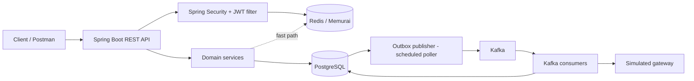
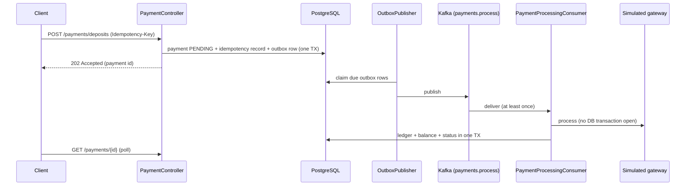

# Payment Processing System

A simplified wallet and money-movement backend: authenticated users hold INR wallets, send money to each other, and fund or cash out through a **simulated** payment gateway. It is a Java 21 / Spring Boot **modular monolith** built to demonstrate financial correctness (double-entry ledger), idempotent APIs, optimistic concurrency, and reliable async processing (transactional outbox to Kafka).

It is a portfolio project, not a payment product: there are no real card networks, no real money, and the gateway is a deterministic simulation.

## Table of contents
- [Architecture](#architecture)
- [Tech stack and responsibilities](#tech-stack-and-responsibilities)
- [Key design decisions](#key-design-decisions)
- [Prerequisites](#prerequisites)
- [Configuration](#configuration)
- [Running locally on Windows](#running-locally-on-windows)
- [API documentation](#api-documentation)
- [Postman demo](#postman-demo)
- [Testing](#testing)
- [Reconciliation](#reconciliation-admin-only-read-only)
- [Simulated gateway](#simulated-gateway)
- [Known limitations](#known-limitations)

## Architecture

Packages under `com.portfolio.paymentsystem` are the module boundaries: `identity`, `wallet`, `ledger`, `transfer`, `payment`, `gateway`, `outbox`, `common`.



Two money flows, kept deliberately separate (different types, tables and logs):

| Flow | Type | Path |
| --- | --- | --- |
| Internal P2P | `Transfer` | Synchronous. One database transaction posts the ledger entries, updates both balances and records the idempotency outcome. No gateway involved. |
| Deposit / withdrawal | `PaymentTransaction` | Asynchronous. The API stores the payment and an outbox row in one transaction and answers `202`. The publisher sends it to Kafka, a consumer calls the simulated gateway, and on success posts the ledger and balance in one transaction. |

The HTTP layer never publishes to Kafka directly. A transfer also writes a `TransferCompleted` outbox event after it commits; it is relayed through the same outbox and consumed idempotently, but the transfer itself never waits on Kafka.



## Tech stack and responsibilities

| Component | Role in this project |
| --- | --- |
| **Java 21, Spring Boot 3.5** (Web, Data JPA, Validation, Security, Actuator) | The application: REST API, domain logic, scheduled outbox publisher, Kafka consumers. Runs directly on the host. |
| **PostgreSQL** | System of record. Accounts, ledger, transfers, payments, idempotency records, outbox and inbox tables. Schema is managed by **Flyway** migrations (`src/main/resources/db/migration`, `V1` to `V6`). |
| **Redis** (Memurai on Windows) | Optional-by-design acceleration and abuse protection: access-token denylist, idempotency fast-path cache, per-user rate-limit counters. Never the source of truth for money. |
| **Apache Kafka** (KRaft, no ZooKeeper) | Async transport for payment processing (`payments.process`), transfer-completed events (`transfers.completed`) and dead-letter topics (`payments.dlq`, `transfers.dlq`). Used only through the outbox. |
| **JJWT** | HS256 access tokens plus opaque rotating refresh tokens (stored hashed). |
| **springdoc-openapi** | Swagger UI and the OpenAPI document. |
| **JUnit 5, Mockito, spring-kafka-test, spring-security-test** | Unit and integration tests against the same local PostgreSQL / Redis / Kafka (no Testcontainers, no Docker). |

Docker is **not** required. Connection details come from environment variables, so containers can be added later without code changes.

## Key design decisions

- **Double-entry ledger as source of truth.** `LedgerService.postTransaction` is the single write path for money. Every posting must balance (debits equal credits) and is stored as immutable `ledger_entries` under a `ledger_transactions` header. Database triggers reject any `UPDATE` or `DELETE` on both tables. `accounts.balance_paise` is a materialized cache updated in the same transaction as the entries. Deposits and withdrawals move money against a seeded system `CLEARING` account, which is allowed to go negative; user accounts cannot (`CHECK` constraint). Amounts are integer paise, INR only.
- **Duplicate-post guard.** `ledger_transactions (reference_type, reference_id)` is unique, so the same transfer or payment cannot post twice even if application code is called twice.
- **Transactional outbox.** Domain rows and `outbox_events` rows are written in one transaction; `OutboxPublisher` polls due rows, publishes them and marks them `PUBLISHED`. This avoids the "committed but never sent" dual-write bug. Rows carry their own topic and DLQ topic, so the publisher stays generic.
- **Idempotent consumers.** An `inbox_events` row keyed by event id is inserted before applying an event; a unique violation means "already handled". Payment settlement is also protected by the ledger reference guard, so Kafka redelivery cannot double-credit.
- **Client idempotency.** Transfer, deposit and withdrawal creation require an `Idempotency-Key` header. PostgreSQL (`idempotency_records`) is authoritative. Same key and same body replays the original result with `200`; same key with a different body returns `422 IDEMPOTENCY_KEY_REUSED`; a concurrent in-flight duplicate returns `409`. Redis only mirrors outcomes as a fast path, and a Redis miss or failure falls through to PostgreSQL rather than skipping the check.
- **Optimistic locking only.** `Account` has a `@Version` column; there is no `SELECT ... FOR UPDATE`. A transfer retries a bounded number of times (`TRANSFER_MAX_LOCK_ATTEMPTS`, default 3) and then returns `409 TRANSFER_CONFLICT`. Withdrawals check the balance at creation as a fast rejection and again at settlement.
- **JWT access and refresh tokens, with a denylist.** Access tokens are short-lived (default `PT15M`). Refresh tokens are rotated on use; reusing an already-rotated token revokes the user's sessions. Logout stores the access token's `jti` in Redis until it would expire. This check **fails closed**: if Redis is unreachable, a token is treated as revoked (`401`).
- **Rate limiting.** Per user and per endpoint (`TRANSFER_CREATE`, `PAYMENT_DEPOSIT`, `PAYMENT_WITHDRAWAL`), counted in Redis with default 20 requests per `PT1M`. Exceeding it returns `429` with `Retry-After`. It **fails open** if Redis is unreachable, because PostgreSQL already guarantees financial correctness.
- **Retries and DLQ.**
  - Outbox publishing retries with exponential backoff up to `OUTBOX_MAX_ATTEMPTS`, then the row is marked `FAILED` and a dead-letter entry is sent to its DLQ topic.
  - Consumers retry a failing message (`OUTBOX_CONSUMER_MAX_ATTEMPTS`) and then publish a consume-failure entry to the DLQ.
  - Gateway failures that are retryable create a new attempt with backoff (`PAYMENT_*` settings). After `PAYMENT_MAX_GATEWAY_ATTEMPTS` the payment becomes `REQUIRES_MANUAL_REVIEW` and an exhaustion event is emitted; permanent declines become `FAILED` immediately.
- **Errors.** RFC 7807 Problem Details with a stable `code` field.

## Prerequisites

- **JDK 21** (`java -version`). Maven is bundled via the wrapper (`mvnw.cmd`).
- **PostgreSQL** running on the host, with an empty database (default name `payment_system`) and a user that can create tables.
- **Redis-compatible server**: Memurai on Windows (or Redis on other platforms).
- **Apache Kafka** in KRaft mode, reachable at `localhost:9092` by default. Kafka is needed for deposits/withdrawals and transfer events.
- Optional: **Postman** (or Newman) for the demo.

Without a running broker, deposits and withdrawals cannot be delivered and will not settle; start Kafka before the application.

## Configuration

Settings are read from environment variables referenced in `src/main/resources/application.yml`; [.env.example](.env.example) lists all of them with defaults.

**Spring Boot does not load `.env` automatically.** Copying `.env.example` to `.env` has no effect by itself. You must set the variables as real OS environment variables in the shell that starts the app (or in your IDE run configuration, or export the file with your own tooling).

Required (no default; the app will not start without them): `POSTGRES_USER`, `POSTGRES_PASSWORD`, `JWT_SECRET`.

`JWT_SECRET` must be a Base64 string that decodes to at least 256 bits. Generate your own and never commit it.

PowerShell (current session only):

```powershell
$env:POSTGRES_USER     = "<your-postgres-user>"
$env:POSTGRES_PASSWORD = "<your-postgres-password>"

# Generate a random 512-bit Base64 secret for this session
$bytes = New-Object byte[] 64
[System.Security.Cryptography.RandomNumberGenerator]::Create().GetBytes($bytes)
$env:JWT_SECRET = [Convert]::ToBase64String($bytes)

# Only if you differ from the defaults (localhost:5432, payment_system, localhost:6379, localhost:9092):
# $env:POSTGRES_HOST = "localhost"
# $env:POSTGRES_PORT = "5432"
# $env:POSTGRES_DB   = "payment_system"
# $env:REDIS_HOST = "localhost"
# $env:REDIS_PORT = "6379"
# $env:KAFKA_BOOTSTRAP_SERVERS = "localhost:9092"
```

Optional tuning (rate limit, outbox, payment retries, gateway scenario bounds) is documented in `.env.example`.

## Running locally on Windows

The exact commands for PostgreSQL, Memurai and Kafka depend on how you installed them; the ones below are typical, so adjust service names and paths to your machine.

1. **PostgreSQL**
   ```powershell
   Get-Service postgresql*            # find the service name, e.g. postgresql-x64-18
   Start-Service <service-name>       # if it is not running
   psql -U <your-postgres-user> -c "CREATE DATABASE payment_system;"   # first time only
   ```
   Flyway creates the tables on first startup.

2. **Memurai (Redis)**
   ```powershell
   Get-Service Memurai
   Start-Service Memurai              # if stopped
   memurai-cli ping                   # expect PONG
   ```

3. **Kafka (KRaft)** - from your Kafka installation directory. Script names and the config path vary between Kafka versions; the following matches distributions that ship `bin\windows` and `config\kraft`:
   ```powershell
   .\bin\windows\kafka-storage.bat random-uuid
   .\bin\windows\kafka-storage.bat format -t <uuid-from-previous-command> -c .\config\kraft\server.properties   # first time only
   .\bin\windows\kafka-server-start.bat .\config\kraft\server.properties
   ```
   The application creates its four topics on startup (`transfers.completed`, `transfers.dlq`, `payments.process`, `payments.dlq`; one partition, one replica).

4. **Application** - from the repository root, in the shell where the environment variables are set:
   ```powershell
   .\mvnw.cmd spring-boot:run
   ```
   or build and run the jar:
   ```powershell
   .\mvnw.cmd -DskipTests package
   java -jar target\payment-processing-system.jar
   ```

5. **Check it is up**
   ```powershell
   curl http://localhost:8080/actuator/health
   ```
   The default health indicators report the database and Redis. (There is no dedicated Kafka health indicator.)

## API documentation

- Swagger UI: <http://localhost:8080/swagger-ui.html>
- OpenAPI JSON: <http://localhost:8080/v3/api-docs>
- In Swagger UI, use **Authorize** and paste an access token from `/auth/login` (security scheme `bearerAuth`).

Base path `/api/v1`. All endpoints except register, login, refresh, health, info and the Swagger paths require `Authorization: Bearer <accessToken>`.

| Method | Path | Notes |
| --- | --- | --- |
| POST | `/auth/register` | `201`; email plus password (8-72 chars, at least one letter and one digit) |
| POST | `/auth/login` | `200`; returns `accessToken`, `refreshToken`, `tokenType`, `expiresInSeconds` |
| POST | `/auth/refresh` | `200`; rotates the refresh token |
| POST | `/auth/logout` | `204`; revokes the refresh token and denylists the access token |
| GET | `/users/me` | Current user |
| POST | `/accounts` | `201`; opens the caller's single INR wallet (`409` if one exists) |
| GET | `/accounts/me` | Balance (`balance.amountPaise`) |
| GET | `/accounts/{id}/ledger` | Newest-first, paged; own account only |
| POST | `/transfers` | Requires `Idempotency-Key`; body `{ "toUserId": "<uuid>", "amountPaise": 25000 }`; `201` (replay `200`) |
| GET | `/transfers/{id}`, `/transfers` | Sender or recipient only; list supports `status`, `page`, `size` |
| POST | `/payments/deposits` | Requires `Idempotency-Key`; body `{ "amountPaise": 100000 }`; `202` (replay `200`) |
| POST | `/payments/withdrawals` | Same contract; `400 INSUFFICIENT_BALANCE` if the balance is too low |
| GET | `/payments/{id}`, `/payments` | Own payments; list supports `type`, `status`, `page`, `size` |
| GET | `/admin/reconciliation` | **ADMIN role only.** Read-only consistency report (see [Reconciliation](#reconciliation-admin-only-read-only)); `401` without a token, `403` for `USER` |
| GET | `/actuator/health`, `/actuator/info` | Public |

Amounts are integer paise (`100000` = INR 1000.00). Payment statuses: `PENDING`, `PROCESSING`, `RETRYING`, `SUCCEEDED`, `FAILED`, `REQUIRES_MANUAL_REVIEW`. Transfer statuses: `PENDING`, `COMPLETED`, `FAILED` (transfers complete synchronously as `COMPLETED`).

Common error codes: `VALIDATION_FAILED`, `MISSING_REQUIRED_HEADER`, `IDEMPOTENCY_KEY_REUSED`, `INSUFFICIENT_BALANCE`, `SELF_TRANSFER_NOT_ALLOWED`, `RECIPIENT_ACCOUNT_NOT_FOUND`, `ACCOUNT_ALREADY_EXISTS`, `EMAIL_ALREADY_EXISTS`, `INVALID_CREDENTIALS`, `PAYMENT_ACCESS_DENIED`, `ACCOUNT_ACCESS_DENIED`, `RATE_LIMIT_EXCEEDED`.

## Postman demo

Files in `postman/`:
- `payment-system.postman_collection.json`
- `payment-system.local.postman_environment.json`

Steps:
1. Start PostgreSQL, Memurai, Kafka and the application (all four are needed for the payment steps).
2. In Postman: **Import** both files, then select the environment **Payment System - Local** (`baseUrl` is `http://localhost:8080`).
3. Run the folders in order with the **Collection Runner**. Polling requests re-run themselves and need the runner (or Newman); sent by hand, click Send until the status is terminal.

| Folder | What it does |
| --- | --- |
| `00 Health` | Actuator health check |
| `01 Happy path` | Register Alice and Bob, log in, open accounts, deposit, poll the payment to `SUCCEEDED`, transfer Alice to Bob, then check both balances and ledgers |
| `02 Negative cases` | Auth failures, validation, idempotency replay (`200`) and key reuse (`422`), insufficient funds, self-transfer, unknown recipient, cross-user access (`403`), a declined deposit (`FAILED`) and a retry-exhausted deposit (`REQUIRES_MANUAL_REVIEW`) |
| `03 Session` | Refresh-token rotation, logout, and a `401` for the logged-out token |
| `04 Rate limit (optional)` | 25 rapid withdrawals as Bob; expects `429` with `Retry-After`. Throttles Bob's withdrawal endpoint for up to a minute |

The collection and environment contain only a throwaway demo password (`DemoPassw0rd!`) and generate unique emails per run. Optional Newman run (requires Node.js):

```powershell
npx newman run postman/payment-system.postman_collection.json -e postman/payment-system.local.postman_environment.json
```

## Testing

Most integration tests use the **real local services** and are skipped unless the matching environment variables are present in the shell:

- Database / context tests need `POSTGRES_USER`, `POSTGRES_PASSWORD` and `JWT_SECRET` (and a reachable PostgreSQL and Redis).
- The three Kafka tests (`OutboxPublisherKafkaIntegrationTest`, `TransferCompletedConsumerKafkaIntegrationTest`, `PaymentFullFlowIntegrationTest`) additionally need `KAFKA_BOOTSTRAP_SERVERS` and a running broker.

Maven activates the `test` profile (`src/test/resources/application-test.yml`), which turns the scheduled outbox publisher and `@KafkaListener` auto-start off by default so tests that do not need Kafka never touch it. Surefire runs tests with `-Xmx512m`.

**Run the suite in batches.** On the 4 GB development machine, running the entire suite in one Maven invocation repeatedly exhausted Windows native memory. The suite was therefore executed as **separate Maven runs**, not as one full-suite invocation, and **no single full-suite run is claimed to pass**. `clean` is used only in Batch 1; Batches 2 to 4 use a fresh JVM fork per test class (`-DforkCount=1 -DreuseForks=false`) to reduce memory pressure.

**Batch 1 - unit/service tests (117 reported tests)**

```powershell
.\mvnw.cmd clean test "-Dtest=MoneyTest,LedgerPostingRequestTest,JwtServiceTest,InMemorySimulatedPaymentGatewayTest,IdempotencyCacheServiceTest,IdempotencyServiceTest,RateLimiterServiceTest,RateLimitInterceptorTest,JwtAuthenticationFilterTest,RefreshTokenServiceTest,TokenDenylistServiceTest,AuthServiceTest,LedgerServiceTest,InboxEventGuardTest,OutboxPublisherTest,PaymentExecutionServiceTest,PaymentOutcomeServiceTest,PaymentServiceTest,TransferCompletedListenerTest,TransferExecutionServiceTest,TransferServiceTest"
```

**Batch 2 - PostgreSQL integration tests (46 reported tests)**

```powershell
.\mvnw.cmd test "-Dtest=RateLimitControllerIntegrationTest,AuthControllerIntegrationTest,LedgerServiceIntegrationTest,PaymentControllerIntegrationTest,PaymentOutboxIntegrationTest,PaymentSystemApplicationTests,TransferControllerIntegrationTest,TransferOutboxIntegrationTest,AccountControllerIntegrationTest" "-DforkCount=1" "-DreuseForks=false"
```

**Batch 3A - Outbox Kafka integration (2 tests)**

```powershell
.\mvnw.cmd test "-Dtest=OutboxPublisherKafkaIntegrationTest" "-DforkCount=1" "-DreuseForks=false"
```

**Batch 3B - payment flow and Kafka consumer (7 tests)**

```powershell
.\mvnw.cmd test "-Dtest=PaymentFullFlowIntegrationTest,TransferCompletedConsumerKafkaIntegrationTest" "-DforkCount=1" "-DreuseForks=false"
```

**Batch 4 - concurrency tests (4 tests)**

```powershell
.\mvnw.cmd test "-Dtest=RateLimiterConcurrencyIntegrationTest,TransferConcurrencyIntegrationTest" "-DforkCount=1" "-DreuseForks=false"
```

According to the project author's results, these separately executed batches totalled **176 reported tests with zero failures, errors or skips**. (117 + 46 + 2 + 7 + 4 = 176.) Batches 3A and 3B need Kafka and `KAFKA_BOOTSTRAP_SERVERS`; a test skipped because of a missing environment variable is reported as skipped, not passed, so check the Maven summary.

**Batch 5 - reconciliation tests (added after the 176-test run; not part of that total)**

```powershell
.\mvnw.cmd test "-Dtest=ReconciliationReportTest,ReconciliationQueriesTest,ReconciliationServiceTest"
.\mvnw.cmd test "-Dtest=ReconciliationQueriesIntegrationTest,ReconciliationServiceIntegrationTest,ReconciliationControllerIntegrationTest" "-DforkCount=1" "-DreuseForks=false"
```

The first command is pure unit tests. The second needs PostgreSQL and Redis plus `POSTGRES_USER`, `POSTGRES_PASSWORD` and `JWT_SECRET`; it does not need Kafka.

Results, recorded as two **separate runs** (neither is part of the 176-test total above):

| Run | Tests | Failures | Errors | Skipped |
| --- | --- | --- | --- | --- |
| Reconciliation unit tests (first command, earlier run) | 17 | 0 | 0 | 0 |
| Reconciliation integration tests (second command, separate run) | 23 | 0 | 0 | 0 |

**Regression re-run after the reconciliation changes.** Per the project author's results, all four regression batches (Batch 1, Batch 2, Batches 3A/3B, Batch 4) were run again after the reconciliation work was added, and passed. These re-runs are separate Maven runs, kept distinct from the original 176 reported tests; they are not added to that figure. As before, **no single full-suite invocation is claimed to pass**.

## Reconciliation (admin-only, read-only)

`GET /api/v1/admin/reconciliation` returns a `ReconciliationReport`: `generatedAt`, `clean`, `errorCount`, `warningCount` and a list of per-check results (`checkId`, `name`, `severity`, `violationsReturned`, `truncated`, `findings`). It **only reads**; it never repairs balances or changes any financial record.

| Check | Severity | What it verifies |
| --- | --- | --- |
| R1 | `ERROR` | Each account's `balance_paise` equals the signed sum of its ledger entries (`CREDIT` positive, `DEBIT` negative), clearing account included |
| R2 | `ERROR` | Every ledger transaction has at least two entries and its debits equal its credits |
| R3 | `ERROR` | System-wide account balances sum to zero, and all signed ledger entries sum to zero |
| R4 | `ERROR` | A `SUCCEEDED` payment has a settlement ledger transaction with the right amount and direction on its account (`DEPOSIT` credits, `WITHDRAWAL` debits); a payment that is not `SUCCEEDED` has none; no payment ledger transaction points at a missing payment |
| R5 | `ERROR` | A `COMPLETED` transfer has a debit on the source and a credit on the destination, both for the transfer amount; a transfer that is not `COMPLETED` has no ledger transaction; no transfer ledger transaction points at a missing transfer |
| R6 | `WARNING` | Outbox events in `FAILED`; `PENDING`/`PUBLISHING` outbox events overdue by more than the stale threshold; payments stuck in `PENDING`/`PROCESSING`/`RETRYING` longer than the threshold |

- `clean` is `true` when there are **no `ERROR` findings**. R6 warnings are counted in `warningCount` but never make the report dirty, because stuck or failed async work can be transient and says nothing about whether the money is right.
- Each check returns at most `app.reconciliation.max-findings` findings (default 50) and sets `truncated: true` if more exist. `app.reconciliation.stale-after` (ISO-8601 duration, default `PT15M`) sets the R6 threshold. These are optional properties with in-code defaults.
- The whole run happens in one **read-only, `REPEATABLE READ`** transaction so every check sees the same snapshot (a transfer committing mid-run cannot create a false finding). The service asks PostgreSQL which transaction it is really in and refuses to run unless it is read-only `REPEATABLE READ`, so calling it from inside another transaction fails loudly instead of silently running with weaker guarantees.
- Findings contain ids and amounts only (no emails or tokens). The checks are full-table aggregates, which is fine at portfolio scale but is not designed for very large tables.

**Access.** The endpoint is protected by `@PreAuthorize("hasRole('ADMIN')")` (method security is enabled in `MethodSecurityConfig`). There is **no admin registration or login flow**: `register` always creates `USER`, and the seeded `ADMIN` system user is disabled and cannot log in. To use the endpoint locally you must make a *deliberate, development-only* change in your own local database, for example:

```sql
-- Local development only. Never automate this and never run it against a shared or real database.
UPDATE users SET role = 'ADMIN' WHERE email = '<the-demo-user-email>';
```

Then log in again: the role is a claim inside the access token, so a token issued before the promotion still says `USER`. The application never performs this promotion itself.

## Simulated gateway

The gateway is deterministic: `amountPaise % 100` selects the scenario (the bounds are configurable via `GATEWAY_*` variables).

| `amountPaise % 100` | Behaviour | Payment ends as |
| --- | --- | --- |
| 0 - 79 | Succeeds | `SUCCEEDED` (ledger posted, balance updated) |
| 80 - 89 | Fails once, succeeds on retry | `RETRYING`, then `SUCCEEDED` |
| 90 - 94 | Fails retryably on every attempt | `REQUIRES_MANUAL_REVIEW` after `PAYMENT_MAX_GATEWAY_ATTEMPTS` (default 3) |
| 95 - 99 | Permanent decline | `FAILED` |

No ledger entry exists for a payment until the gateway succeeds, so a non-succeeded payment never moves money. If a withdrawal's balance has dropped by settlement time, it fails with `Insufficient balance at settlement`.

## Known limitations

- The gateway is a simulation; there are no real card networks, PCI scope or webhooks.
- INR only; amounts are integer paise. One wallet per user.
- Exactly one local broker with single-partition, single-replica topics; no Kafka security configuration.
- Rate limiting is a fixed window per user and endpoint, and fails open if Redis is down; the token denylist fails closed.
- A seeded system user exists for the clearing account and cannot log in. There is no admin registration or login flow; the only admin endpoint is the reconciliation report, reachable only after a manual, development-only database promotion of a user (see [Reconciliation](#reconciliation-admin-only-read-only)).
- Reconciliation is an on-demand, read-only report: no scheduler, no alerting, no automatic repair, and full-table scans rather than incremental checks.
- No metrics stack, no frontend, no Docker setup, and no CI pipeline are included.
- The full test suite has not been verified as a single Maven run on the development machine; see [Testing](#testing).
